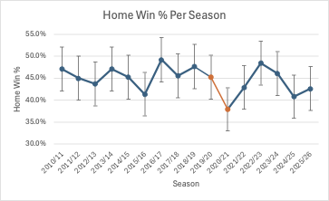
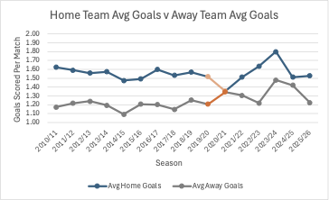
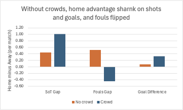

# Premier-League-Home-Advantage
# Did crowds drive home advantage in the Premier League?

## Question
How has home advantage in the Premier League changed over 16 seasons (2010/11 to 2025/26), and did it fall when matches were played without crowds in 2019/20 and 2020/21?

## Summary of findings
- Across all 6,080 matches, the home side won **44.7%**, drew 24.2% and lost 31.0%.
- Home win rates varied between **37.9% and 49.2%** by season. 2020/21, played almost entirely behind closed doors, had the lowest home win rate (37.9%) and the highest away win rate (40.3%).
- In the 472 no-crowd matches, the home win rate was **39.6%**, against **45.2%** in the 5,608 matches with crowds. That is a **5.6 percentage point drop** (z = -2.33, p = 0.02). The 95% margin of error on the difference is about ±4.6 points, so the true effect could be small or large.
- Home advantage in goals fell from **0.33 goals per match with crowds to 0.08 without**.
- Two other things changed without crowds:
  - The home side's shots-on-target advantage fell from about 1.0 to 0.4 per match.
  - Home teams went from committing fewer fouls than away teams (-0.45 per match) to more (+0.52).

*Home win % per season with 95% confidence intervals. Orange marks the 2019/20 restart and 2020/21, the seasons played without crowds.*

*Home teams outscore away teams in almost every season. In 2020/21 the gap nearly disappeared.*

*Home-minus-away gaps with and without crowds. A higher fouls gap means home teams commit more fouls than their opponents.*

## What this suggests
Home advantage was weaker without crowds. The pattern is consistent with crowds affecting both team performance (fewer shots on target relative to opponents) and refereeing (the swing in fouls). This is suggestive, not proof of cause.

## Data
Match results and statistics from football-data.co.uk, one file per season, 380 matches each. Columns used: date, teams, full-time score and result, shots, shots on target, fouls and red cards.

## Method
1. Imported 16 season files into Excel with Power Query and combined them into one table.
2. Cleaned the data: read dates with a UK locale, removed odds columns, and removed a blank trailing row found in the 2014/15 file.
3. Checked the data: 380 matches per season (6,080 total), consistent team names, no missing values, and the result column agreed with the scores in every row.
4. Added helper columns for home/draw/away flags, points, goal difference and a "no crowd" flag.
5. Calculated per-season home win rates with 95% confidence intervals.
6. Compared home win rates with and without crowds using a two-proportion z-test.
7. Compared shots on target, fouls and red cards (home minus away) across the two conditions.

"No crowd" means the 2019/20 restart (from 17 June 2020) and all of 2020/21.

## Limitations
- **Small sample:** only 472 no-crowd matches, and a single season's win rate is noisy. 2024/25 (40.8%) and 2015/16 (41.3%) had full crowds and were nearly as low as the no-crowd rate.
- **No control for team quality:** if stronger away sides happened to dominate 2020/21, that could explain part of the drop.
- **The no-crowd flag is approximate:** a few matches late in 2020/21 had limited crowds.
- **Other disruption:** the restart involved a long break and a compressed schedule, which are mixed in with the crowd effect.
- **The mechanism comparison is descriptive:** no significance tests were run on the shots and fouls differences. Fouls conceded also reflect how teams play, not only referee decisions.
- **Red cards** are too rare to say anything about.

## Possible next steps
Repeat the analysis in Python and SQL, control for team strength, and extend to other leagues.

## Files
- `premier-league-home-advantage.xlsx`: workbook with the Matches, Summary, Covid test, Mechanism, Checks and Notes sheets
- `home_win_by_season.png`, `goals_home_vs_away.png`, `mechanism_gaps.png`: chart images
